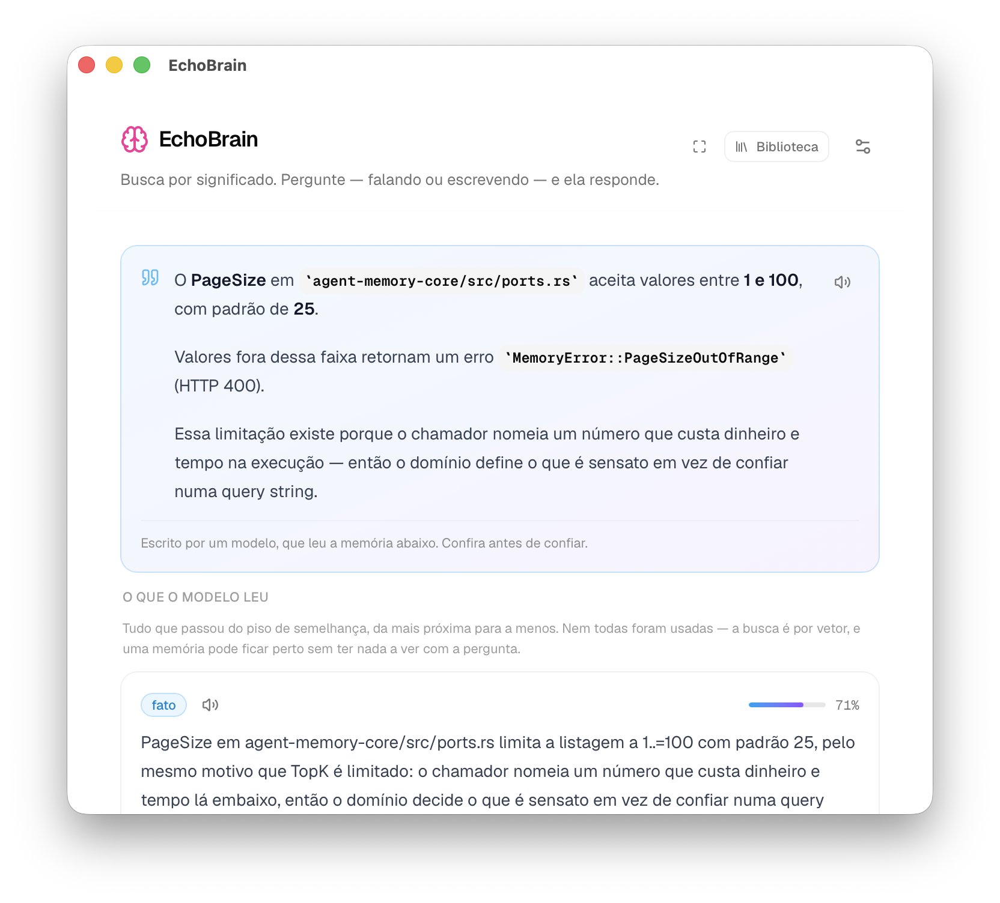
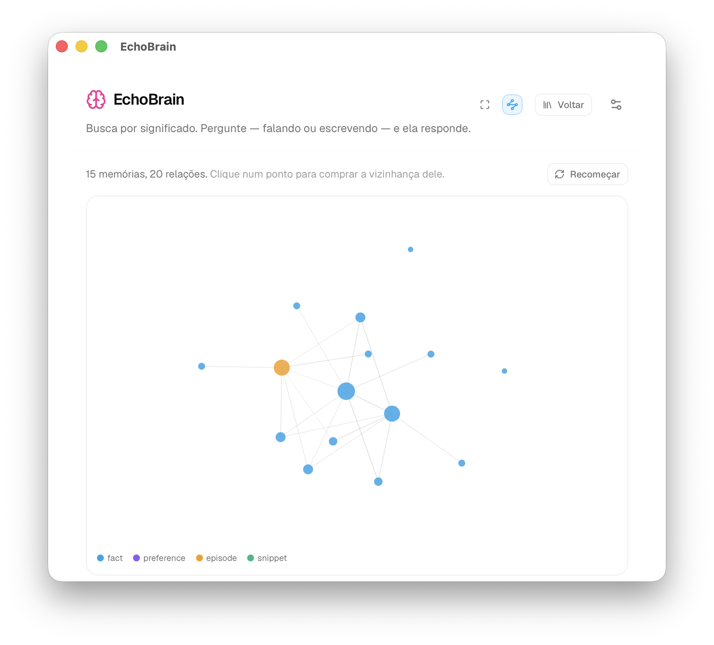
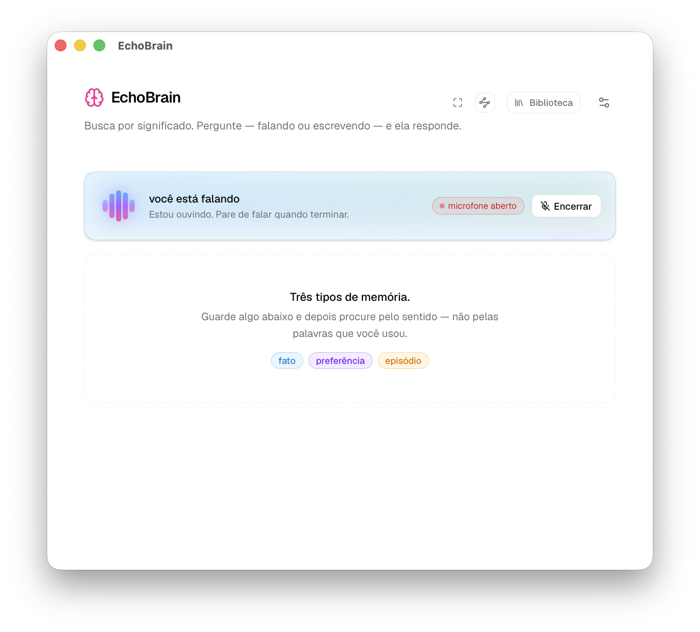
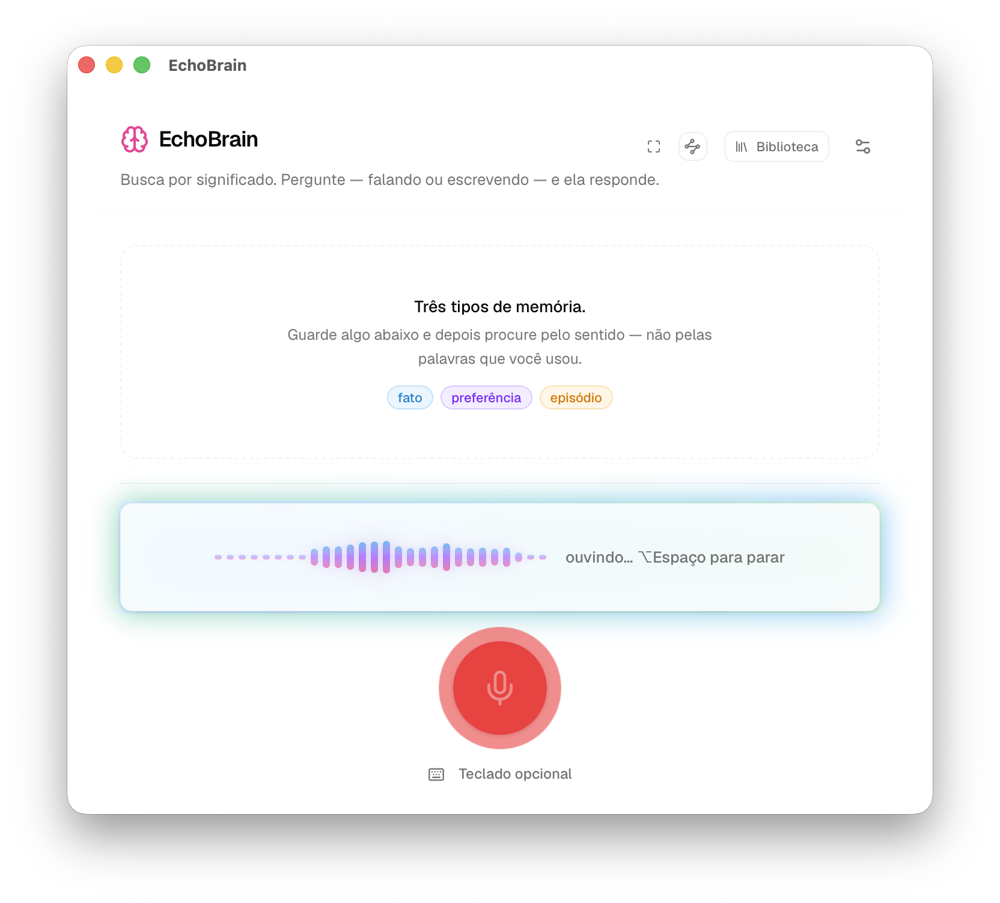
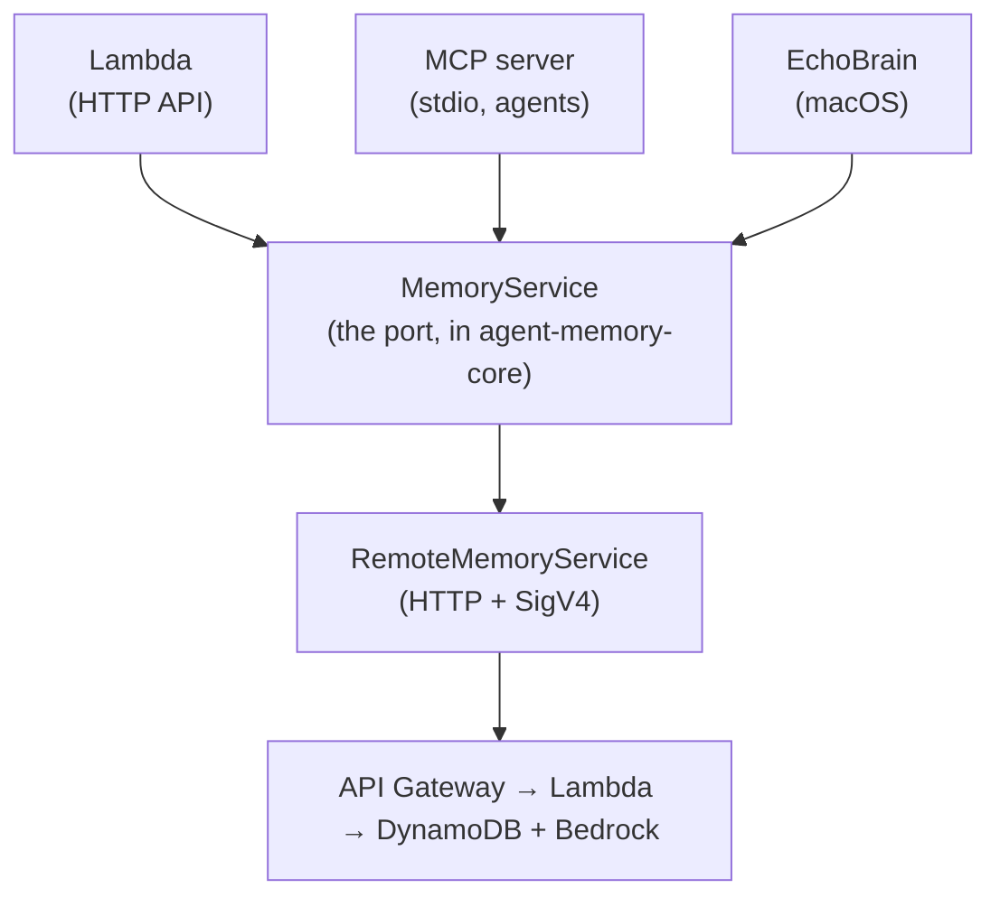

# EchoBrain

Semantic memory for a person, captured by voice, on **DynamoDB vector search**.

<p align="center">
  
</p>

<p align="center">
  <sub><b>1 / 4</b> · A question, answered from the memories — and every memory it
  read, with its similarity, right below the answer. Sources are never collapsed.</sub>
</p>

<details>
<summary><b>Next › 2 / 4 — the memory graph, then voice capture</b></summary>

<p align="center">
  
</p>

<p align="center">
  <sub><b>2 / 4</b> · Nothing links one memory to another, so every edge here was
  <em>asked for</em>: clicking a node buys its neighbourhood with one recall.
  Thickness is similarity; colour is the kind.</sub>
</p>

<p align="center">
  
</p>

<p align="center">
  <sub><b>3 / 4</b> · Dictation is explicit: when the microphone is open, the app
  stays in listening mode and shows it clearly before saving anything.</sub>
</p>

<p align="center">
  
</p>

<p align="center">
  <sub><b>4 / 4</b> · The voice path is designed for quick capture: strong visual
  feedback, one-stop control, optional keyboard follow-up.</sub>
</p>

</details>

<!--
  A `<details>` block rather than a carousel, because GitHub renders README
  markup through a sanitiser: no `<script>`, no `<style>`, no `onclick`, and no
  `:target` CSS. Nothing that could swap an image on click survives it. This is
  the closest working thing — one click, one image at a time, and it degrades to
  all images stacked in any renderer that ignores `<details>`.
-->

Gemini for Mac, the Claude and ChatGPT desktop apps, and terminal tools like
Claude CLI, Codex CLI and Antigravity CLI all share one limitation: the context
dies with the session. You tell them something today and tomorrow they know
nothing about it.

EchoBrain keeps it. What you say becomes a memory searchable **by meaning**, in a
store where the vector lives in the same DynamoDB item as the record.

> Press ⌥Space, say _"we picked a DynamoDB vector index over OpenSearch because
> of the per-byte cost"_, and three weeks later — here, or from an agent reaching
> the same namespace through the MCP server — ask _"why didn't we go with
> OpenSearch?"_ and get it back, without remembering the words you used.

**Scope: capture, search, and — when what you said was a question — answer.**
Speech → local transcription → kind classification → `remember()`, plus a search
UI over everything. Recall is real vector search.

**A question reaches a model; a statement does not.** `CueIntent` routes the
utterance, and it routes the same way whether you spoke it or typed it: recalled
memories go to Claude on Bedrock and come back grounded in them. Spoken, the
answer is three sentences read aloud. Typed, it is markdown on screen, as long as
the memories warrant — the medium is the only difference, and the grounding rules
are byte-identical in both prompts. Anything the router files as a statement
still costs one embedding and nothing more, and with no `answer_model` in
`config.toml` the app never spends a token at all — that is the default.

**Typing costs nothing until you press a button.** The search field used to fire
on a 280 ms timer, which was defended on cost and was wrong on feel: a search is
an embedding plus a vector search across the network, so every pause put a
spinner in the field and cards on screen while the sentence was still
half-written. Now the only thing that runs as you type is `classify_intent` — a
cue-phrase match in Rust, no network — and it earns that by labelling the two
buttons before you commit to either. _Buscar_ and _Guardar_ are both always
there, because taking the timer away would otherwise have left no way at all to
look up a sentence the router files as a statement. Enter runs whichever one the
chip points at; `⌘↵` always searches, because the router is a heuristic and
retyping a sentence to look it up is absurd.

> This used to read _"No LLM, no inference, no token cost."_ It was true, and
> giving it up was a real trade. What recall had going for it was that the
> sentence coming back was the sentence that went in: wrong results were wrong
> _searches_, and the similarity meter showed it. A composed answer can be
> fluent and unsupported, and by voice it arrives where there is nothing to
> skim. Three things guard the difference — a similarity floor below which no
> model is called at all, a prompt closed over the recalled memories with a
> fixed sentence for "not found", and sources rendered under every answer, never
> collapsed. See `usecase/answer.rs`, `echobrain-llm/src/prompt.rs` and
> `answer-card.tsx`; each says why in the file.

## It is a client, not a backend

The memory layer is the sibling project
[`aws-dynamodb-search-vector-rust-example`](../aws-dynamodb-search-vector-rust-example),
already deployed. EchoBrain is a **third driving adapter** on its primary port,
`MemoryService`, next to the Lambda and the MCP server:



So there is no backend code here, no embedding code and no AWS SDK for storage.
`agent-memory-client` already speaks the API.

## Layout

```
crates/echobrain-core    Domain + ports. No Tauri, no cpal, no SQLite, no AWS.
crates/echobrain-audio   Microphone (cpal), transcription (whisper), speech (say).
crates/echobrain-llm     Answering over Bedrock. The only crate that spends money.
crates/echobrain-app     Tauri driving adapter: composition root, IPC commands.
crates/echobrain-journal SQLite journal, reconciler.
ui/                      Next.js (static export) + shadcn/ui.
site/                    The landing page, deployed to GitHub Pages. No app code.
```

The short dependency list in `echobrain-core/Cargo.toml` _is_ the architecture:
the boundary is enforced by the compiler, so an accidental import fails the
build instead of quietly eroding it.

The frontend mirrors the same hexagon. Components depend on the `MemoryGateway`
interface (`ui/src/lib/memory/gateway.ts`); `TauriGateway` and `FakeGateway`
implement it. That is why the whole UI can be built in `next dev` with no Rust
toolchain, no AWS account and no cost.

## Quick start

```bash
make check   # fmt, clippy -D warnings, 174 tests, UI lint + static export. Free.
make ui      # UI work in a browser against FakeGateway. No Rust, no AWS.
make run     # build the UI, then run the app against the deployed API
make smoke   # end-to-end against the deployed API. Costs a few cents.
make site    # the landing page, with hot reload. No Rust, no AWS.
```

`make ui` is where interface iteration belongs: hot reload, seeded fixtures, no
Rust toolchain and no network. The header shows a _dados de exemplo_ badge so
fixtures are never mistaken for real memories.

**`tauri.conf.json` deliberately has no `devUrl`.** With one set, a debug build
points the webview at a dev server rather than at the bundle — so launching the
binary without that server running gives a **silent white window**, no error
anywhere. Without it the window always loads `ui/out`, which is why `make run`
rebuilds the UI first. The cost is no hot reload _inside_ the Tauri window;
`make ui` covers that case better anyway.

### Configuration

`~/Library/Application Support/EchoBrain/config.toml`, all fields optional:

```toml
endpoint = "https://abc123xyz0.execute-api.us-east-1.amazonaws.com/"
region   = "us-east-1"   # the API's region — this is what SigV4 signs for
profile  = "my-profile"
github_login = "your-login"   # attribution only, never authorization
```

A file rather than environment variables because a `.app` opened from the Finder
inherits no shell profile.

**Every field above is editable in the app**, under _Configurações → Conexão_.
The profile is a menu built from `~/.aws/config`, with an SSO login for whichever
one is selected; saving rebuilds the AWS clients in place, so a change takes
effect on the next search rather than on the next launch.

Environment variables still win. `AGENT_MEMORY_API`, `ECHOBRAIN_AWS_REGION` and
`AWS_PROFILE` override the file **at load**, which is convenient under
`tauri dev` and a trap everywhere else: `make run` exports `AWS_PROFILE`, so a
profile chosen in the app would come back to that one on the next launch. The
screen names any that are set rather than letting it happen quietly.

Two others sit _below_ the config layer and outrank it entirely —
`AWS_ENDPOINT_URL` redirects every SDK client, `AWS_ACCESS_KEY_ID` outranks the
named profile. Neither is honoured deliberately, and both are logged by name at
startup when present, because the failure otherwise looks like broken
credentials.

### Staying logged in

The connection screen shows when the SSO session ends, and whether it will renew
itself. That second half is decided entirely by how the profile is written:

```ini
[sso-session my-sso]
sso_start_url = https://d-0123456789.awsapps.com/start
sso_region = sa-east-1
sso_registration_scopes = sso:account:access   # this is what issues a refresh token

[profile my-profile]
sso_session = my-sso
sso_account_id = 000000000000
sso_role_name = AdministratorAccess
region = sa-east-1
```

Written that way, `aws-config` renews the access token from inside this process,
five minutes before it lapses, with no browser — so the app stays usable for as
long as the IAM Identity Center session allows (8 hours by default, up to 90
days, set under _Settings → Authentication_).

Written the old way — `sso_start_url` directly under `[profile x]`, no
`[sso-session]` block — the CLI never asks for the refresh scope, the cached
token has no `refreshToken`, and the SDK takes a code path that cannot refresh
at all. It dies mid-session and every search fails until someone logs in again.
The two shapes are indistinguishable until that moment, which is why the screen
says which one you are on rather than waiting for the failure. See
`crates/echobrain-app/src/sso.rs`.

## Adding an IPC command touches three files

Tauri v2 gates **app** commands behind the ACL, not just plugin commands. Miss a
step and the app still builds, still launches, still looks right — and then
every `invoke()` fails at runtime with _"not allowed. Plugin not found"_.

1. `build.rs` — name it in `AppManifest::commands()`, which autogenerates
   `allow-<kebab-case-name>`
2. `src/lib.rs` — add it to `generate_handler!`
3. `capabilities/default.json` — grant the generated permission

`tests/ipc.rs` builds against `generate_context!()` rather than
`mock_context()`, so it exercises the **real** ACL and fails if any of the three
is missed. A mock context has an empty authority: it denies everything and would
have proved nothing.

## Speech

**⌥Space** — the chord Raycast and the Gemini and Claude desktop apps use —
raises the window and toggles dictation. Speak, press it again, and the
transcript lands in the capture field for you to confirm.

That last step is deliberate. Transcription misreads names and the kind is a
heuristic guess, and a memory you never saw is one you cannot correct: recall
would surface it months later, wrong, with no way to know why.

`echobrain-audio` implements three ports: `AudioCapture` (cpal → rubato → 16 kHz
mono), `Transcriber` (whisper.cpp over Metal, `large-v3-turbo-q5_0`) and
`Speaker` (the macOS system voices, over `say`). Dictation is optional — without
the model the app starts normally, the microphone button is hidden rather than
shown broken, and typing still works. Speech degrades the same way: no pt-BR
voice installed means answers are shown and not spoken.

**What you say is routed, not assumed** — and so is what you type. `CueIntent`
decides between storing an utterance and asking a question — "grava que o deploy
saiu" against "por que a gente não foi de OpenSearch". It is cue phrases, not a
model, for the same reason `CueClassifier` is: routing happens _before_ the
answering path, so paying for inference there would put a token cost on every
capture. That is also what makes it cheap enough to run on every pause in the
search field, where it decides which button Enter presses. It is wrong sometimes,
so the guess shows as an editable chip. Correcting it _acts_ only when the
sentence was dictated — a voice interface that waits for a click is not one —
while on the typed path it just re-labels the buttons, because your hands are
already there and nothing here spends money without being told to. The ambiguous
middle falls to
**storing**, because the two mistakes are not symmetric: a question stored as a
memory is visible and deletable in one click, while a memory routed to a search
is simply thrown away.

Barge-in is in `start_dictation`, not in the frontend: opening the microphone
means the user is talking, so whatever the app was saying stops — whichever of
the button, the hotkey or a future conversation loop opened it.

```bash
make model         # once, ~570 MB + ~26 MB. Not bundled: see crates/echobrain-audio/src/model.rs
make voice-model   # just the speaker-embedding model, needed to enrol a voice
make verify-audio  # proves real Portuguese transcribes
make verify-tts    # proves the voice speaks — say → whisper → assert
make verify-vad    # proves the endpointer finds the edges of real speech
make verify-intent # the record/ask routing table, no I/O
make transcribe    # record 5 s from the microphone and print the transcript
```

**Never test a recogniser against the microphone alone.** macOS hands an
unpermitted process _silence_, not an error, and whisper hallucinates confident
phrases over silence — five seconds of nothing transcribed as "E aí" while this
was being built, which reads exactly like success. `make verify-audio` uses
speech from `say` instead, so the assertion is about the recogniser rather than
about the machine's privacy settings. The microphone path prints its input level
for the same reason: a flat 0.000 is the tell.

## Four things that shape the design

**Search is eventually consistent.** The sibling project's smoke test budgets
90 seconds between a write and that write turning up in a search. A UI that hid
a memory until the index caught up would look broken, so captures appear
immediately as `indexing` and a reconciler promotes them to `indexed`.

**Discovery is semantic first, and listing arrived late.** `GET /memories`
exists now — paginated by cursor, filtered by metadata — and it is what the
Biblioteca reads. It is a filing aid, not a search: `text_contains` is a literal
substring, so a memory whose _words_ you have forgotten is still only reachable
by meaning. Alongside it a local journal records what _this device_ wrote — a
**cache, never an inventory**, kept because it is the only thing that knows a
capture is still `indexing`. Memories written on the phone are absent from it,
and TTL expiries happen server-side without notice, so any view built on it has
to say so rather than imply completeness.

**Nothing links one memory to another.** There is no `[[wikilink]]`, no parent,
no reference field — and the embeddings never leave the backend, deliberately.
So the graph view derives every edge it draws by _asking_: `recall` on a
memory's own text returns its nearest neighbours, one embedding and one vector
search at a time. That is why it expands where you click instead of pre-drawing
the whole store, and why edges from shared `github_repo` or `kind` were
rejected — free, instant, and a picture of the filing cabinet wearing the face
of a meaning graph.

**Distance is backwards from intuition.** A COSINE index returns 0 for identical
and 2 for opposite. `Similarity::from_distance` inverts it once, in the domain,
and no `Distance` ever crosses into the UI — so no view can render it upside
down.

## Status

Phase 0 is done and verified end to end against the deployed API:

```
$ cargo run -p echobrain-app --example smoke
→ gravando: Para o teste …: preferimos índice vetorial no DynamoDB a OpenSearch…
✓ gravado  id=b1217b73-… kind=episode state=indexing
→ buscando por sinônimo: "por que a gente não foi de OpenSearch?"
✓ encontrado em 924ms  similaridade=67%
✓ apagado. Tudo certo.
```

The query shares almost no words with what was stored — that is the whole point.
`clippy -D warnings` clean, 174 tests, static export builds.

The 90-second consistency budget is a ceiling, not an expectation: both observed
runs indexed in under a second. The polling stays because one fast pair of runs
does not retire a documented bound.

| Phase  | What                                                                                 |
| ------ | ------------------------------------------------------------------------------------ |
| ✅ 0   | Walking skeleton — workspace, core, UI, Tauri wired to the real API                  |
| ✅ 1   | ⌥Space dictation: `cpal` → `rubato` → `whisper-rs` (Metal)                           |
| ✅ 1.5 | Voice answers: `Speaker` (`say`), `Answerer` (Bedrock), record/ask routing, settings |
| ✅ 2.5 | Conversation mode — streaming frames, endpointing, barge-in, follow-up window        |
| ✅ 2   | SQLite journal, library view, reconciler, rating and deactivation                    |
| 3      | `NSPanel`, vibrancy, menu-bar icon, animation                                        |
| 4      | Wake word, and the embedding model behind speaker identity                           |

Phase 1.5 is the one that changed the project's shape, and its cost is stated
where it is paid: `answer_model` is absent by default, so a fresh install still
spends nothing, and the settings screen says what filling it in means.

## Conversation

_Conversar_ opens the microphone and keeps it open. The endpointer decides when
you stopped talking, the turn is routed and answered, and the microphone stays
live for a few seconds so the next thing you say continues the exchange.

Talking over the answer stops it mid-word. That one behaviour is what separates
a conversation from a phone menu, and it is why `Speaker::stop` is on the port
rather than left to the adapter.

`echobrain-core/src/usecase/turn.rs` holds the transitions and no I/O — every
rule there is a test, and none of them needs a microphone. The driving is in
`echobrain-app/src/conversation.rs`: a thread that owns the frames and the
detector, a task that runs the slow parts. Two, because frames arrive every
20 ms from a realtime callback that drops rather than waits, while a turn takes
seconds — and missing audio is invisible until someone's first word is gone.

**Whose voice.** `echobrain-core/src/voice.rs` compares an utterance against an
enrolled average and answers _is this probably them_ with a number. It is not a
lock — a recording of you passes it — so it is wired to exactly two things:
dropping what the television said, and stamping who spoke onto the memory. It is
off until enrolled, and the ⌥Space path is **never** filtered: pressing a key is
an unambiguous statement of intent, and refusing it because a cold changed
someone's voice would be broken in the least forgivable way.

### Two changes this project needs in the sibling repository

1. **`RemoteMemoryService::with_config`** _(done)_ — takes an explicit
   `SdkConfig` instead of resolving the ambient credential chain. Required for a
   Finder-launched `.app`, which inherits no shell profile.

2. **The Cognito namespace fix** _(not done — blocking for any second user)_.
   `principal_to_namespace` discards everything after the role name, which is
   correct for SSO (one human, many sessions) but collapses **every Cognito
   user into one namespace**, since they all assume the same role. The payload
   format 1.0 request context also carries `cognitoIdentityId`, unique per
   identity; `caller_namespace` must prefer it. Today every caller is the same
   SSO principal, so nothing is exposed — but no build authenticating through
   Cognito should ship before that lands with tests.
